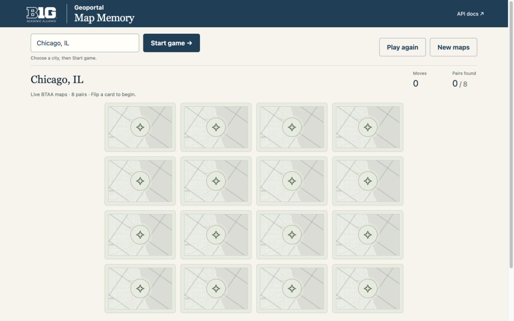
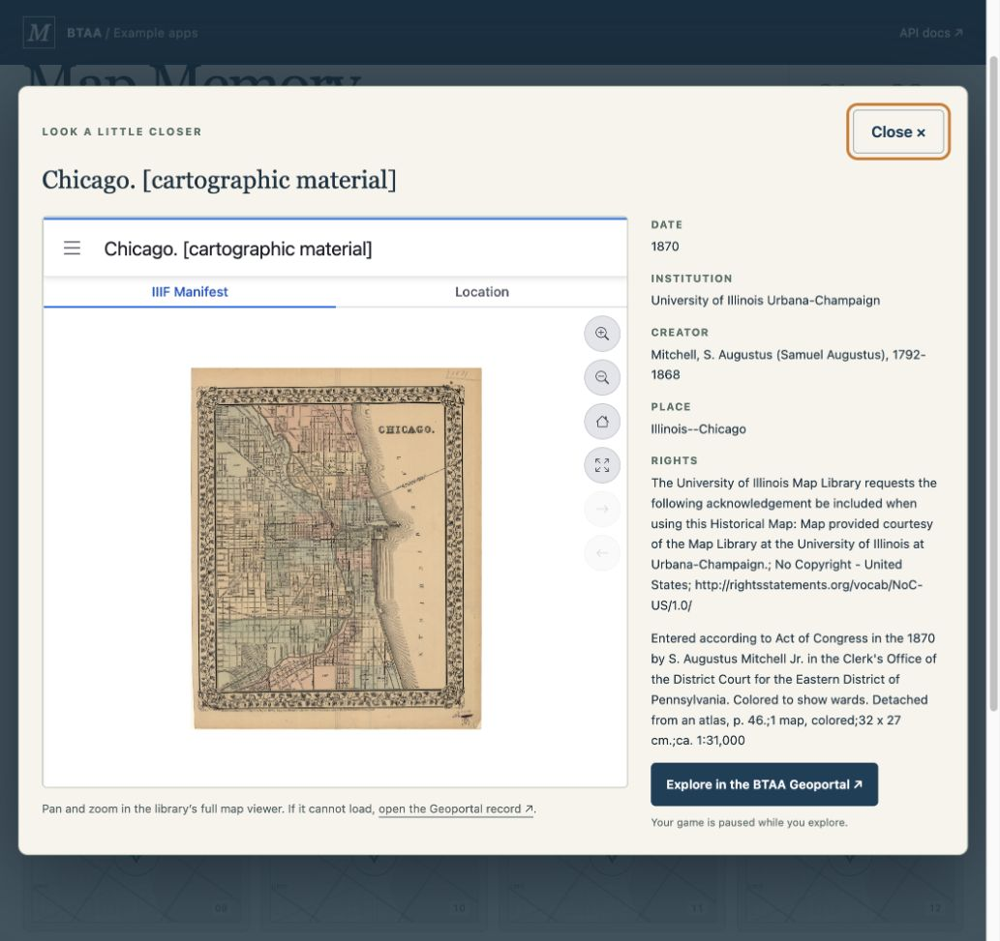
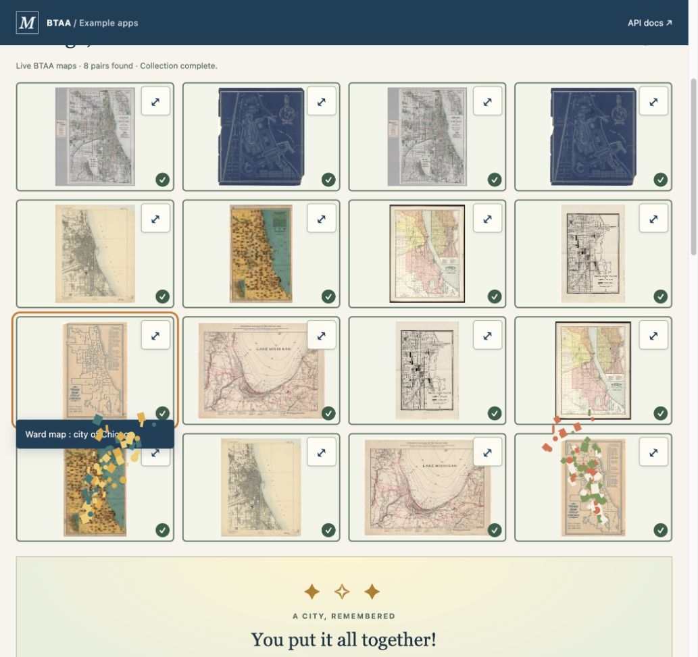
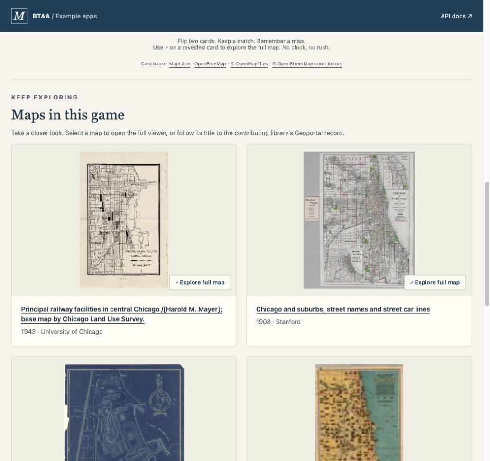
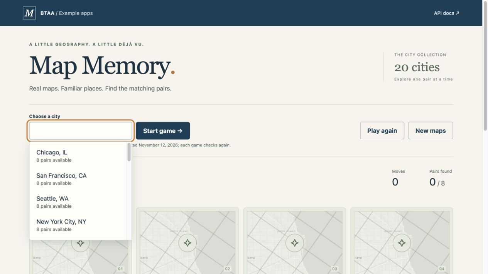

# Map Memory

A buildless HTML/CSS/JavaScript memory game using real BTAA map thumbnails.
Open `index.html` through a static HTTP server, not a `file:` URL.

```sh
# From the repository root
python3 -m http.server 4173
# http://localhost:4173/apps/map-memory/
node --test apps/map-memory/tests/*.test.mjs
```

The repository's Pages workflow uploads the source tree unchanged. The expected
post-merge URL is <https://ewlarson.github.io/api-example-apps/apps/map-memory/>.
This is not a deployed PR preview. Browser verification used
`http://127.0.0.1:4173/api-example-apps/apps/map-memory/` with the repository mounted
under that subpath. No build command or package installation is needed.

## API contracts checked live — November 12, 2026

Read <https://geo.btaa.org/api/docs> and its `/api/openapi.json` schema, then
inspected actual responses:

- `GET /api/v1/search`: JSON:API `data[]`, `attributes.ogm`, `meta.ui`, and
  `meta.totalCount`; `per_page` accepts 1–100. `adv_q` accepts JSON clauses such as
  `[{"op":"AND","f":"dct_title_s","q":"\"Chicago\""}]`.
- `include_filters[gbl_resourceClass_sm][]=Maps` returns Maps records. The fallback
  uses a quoted city + state + map query, then a supported 25 km centroid-distance
  query (`include_filters[geo][type]=distance`, field `dcat_centroid`, city center,
  distance `25km`). All stages retain local relevance checks.
- `meta.ui.thumbnail_url` points to cached `/api/v1/thumbnails/{hash}` images or
  `/api/v1/resources/{id}/thumbnail`. The resource endpoint can redirect to a cached
  raster **or return a generic SVG fallback with HTTP 200**. SVGs are not playable.
- Search and thumbnail requests with `Origin: https://ewlarson.github.io` returned
  `Access-Control-Allow-Origin: *`. Cross-origin fetch, redirect, raster decoding,
  and canvas sampling also succeeded from the local Pages-shaped browser preview.
  No credentials, backend, or static catalog are used.
- `GET /api/v1/resources/{id}/ogm-viewer?embed=true` is the API's supported HTML
  embed, with `Content-Security-Policy: frame-ancestors *`. The lightbox uses this
  full OGM/IIIF viewer, including tiled zoom and multi-page controls. The iframe's
  `scrolling="no"` suppresses its document scrollbars; the viewer's own controls
  remain usable. Metadata comes from the same live search record.

## Geographic coverage

The audit catalog includes 26 cities, preserving the original choices and representing all
14 states in the [BTAA university roster](https://btaa.org/about/member-universities)
and [member-library roster](https://btaa.org/library/who-we-are/member-libraries),
checked November 12, 2026. Chicago also covers the University of Chicago library.

| BTAA state | Representative urban area |
| --- | --- |
| California | Los Angeles (also San Francisco and San Diego) |
| Illinois | Chicago |
| Indiana | Indianapolis (alias: Indy) |
| Iowa | Des Moines |
| Maryland | Baltimore |
| Michigan | Detroit |
| Minnesota | Minneapolis |
| Nebraska | Omaha |
| New Jersey | Newark |
| Ohio | Columbus |
| Oregon | Portland |
| Pennsylvania | Philadelphia |
| Washington | Seattle |
| Wisconsin | Milwaukee |

A regression test protects the audit catalog’s state-to-city coverage. The picker
only includes cities with at least four verified maps. Iowa and Wisconsin remain
in the audit catalog for restoration when enough map imagery becomes available.
The [dated coverage audit](COVERAGE.md) records all 26 cities and accepted resource
IDs. The revised pipeline finds 20 playable cities: 17 full boards, plus Columbus
and Portland with four pairs and San Diego with seven. Atlanta, Denver, Des Moines,
Miami, Milwaukee and New Orleans still fall below four maps and are hidden from
the picker. The 20 selectable cities show their board size before selection.
Each game checks live availability again; if a previously playable city falls below
four, it is removed from the picker for the session and offers retry/alternatives.
API failures do not remove a city. A future coverage refresh can restore hidden cities.

## Selection and game behavior

`core.mjs` keeps display labels/aliases separate from canonical search terms and
coordinates. Searches require city evidence in the title or geographic subject;
publisher, institution, and description mentions never establish relevance.
Bounds reject distant, statewide, and national maps. Narrow, individually reviewed
exceptions in `quality.mjs` recover city sheets with coarse catalog bounds and
local camp/survey maps. West New York, NJ and unrelated route-series segments are
excluded. Atlas/insurance volumes, cover/index identifiers, Maps Index masks and
known non-map previews are excluded. Four records with cover thumbnails use a
reviewed page-2 map image from their API-linked IIIF manifests; an exact manifest
match is required and the lightbox identifies the preview page.

`api.mjs` requests up to 100 records per query and inspects at most 48 candidates,
four thumbnails at a time. Distinctive subjects are prioritized, with a randomized
remaining sample. Up to 23 usable images are retained in memory. Dedupe covers IDs,
normalized titles, thumbnail URLs, SHA-256 image bytes, spatially similar 12×12 RGB
samples, and reviewed groups of visually repeated editions. Similar paper color
alone does not reject a map. Tiny/narrow images, blank sheets and black/white raster
masks fail image validation. Accepted images are decoded into local blob URLs
before play; URLs are released on city change/cancel. HTTP errors, rate limits and
timeouts are reported separately from rejected imagery. See [coverage notes](COVERAGE.md)
for the exact audit, quality rules and remaining collection gaps.

Eight maps produce 16 shuffled cards. Four to seven produce a smaller board with
an explanation; fewer than four expose retry and city-switch guidance. Play again
reshuffles the same maps. New maps draws from the validated pool, prioritizing
unused resources so the selection changes; it is disabled when there are no extras.
A new city selection starts a fresh live request. Generation checks protect against
both late successes and late errors, even if an underlying loader ignores abort.

Cards are real buttons with concealed identities until revealed, persistent focus,
and polite match announcements. Mismatches remain visible for 1100ms, blocking a
third activation. Explore controls appear only on revealed cards and open a native
modal dialog with full image, dates, institution, creator, place, rights, description,
and a Geoportal link. The mismatch clock pauses while exploring; Escape/Close returns
focus to the card and resumes play. Revealed cards show their titles after a 450ms
hover dwell, immediately on keyboard focus, and dismiss on Escape; face-down title
content stays empty. A win fires a local canvas confetti burst once per game, with
cleanup on replay/city switch. Reduced motion uses the festive static completion
panel instead. The post-game collection uses 260–360px-tall previews that open the
same full-map lightbox; title links still lead to the Geoportal.

## Header branding

The header uses the official white [BTAA logo](https://geo.btaa.org/btaa-logo.png)
from the Geoportal, bundled locally in `assets/btaa-logo.png` with its original
transparency and aspect ratio. The logo sits to the left of “Geoportal” above
“Map Memory”, separated by a pale vertical rule with balanced spacing;
the lockup links back to the example-app gallery. The footer credits
the BTAA Geospatial API and links to its documentation.

The title lives in the compact header so the game starts directly beneath it.
The four-column board adapts card height to the viewport, keeping all 16 cards
visible at the verified desktop and phone sizes. Cards have no decorative numbers;
accessible position labels remain. A minimum card height preserves usable targets
on very short screens, where scrolling may still be necessary.

## City basemap backs

The original compass/line design overlays a grayscale MapLibre rendering centered
on the selected city. One temporary WebGL map produces a shared snapshot for all
cards, then releases its renderer. City snapshots are cached in memory. Switching
cities cancels old renders and clears the old background immediately. The original
card pattern remains usable if WebGL, the CDN, or tiles are unavailable.

- Pinned MapLibre GL JS 5.24.1 browser bundle from unpkg (no build dependency).
- [OpenFreeMap Positron](https://openfreemap.org/quick_start/) vector basemap,
  with OpenFreeMap, OpenMapTiles, and OpenStreetMap attribution below the board.
- [MapLibre map options](https://maplibre.org/maplibre-gl-js/docs/API/type-aliases/MapOptions/)
  for canvas snapshot rendering. No basemap credentials are needed.

## Verification

- 44 repeatable Node tests: deck construction, dedupe/relevance, pair matching,
  mismatch timing, reset, modal pause/resume, stale city success/error, cancellation
  cleanup, unusable images, 3/4/7/8-map results, fallback queries, Pages assets, and
  one-shot confetti, replay cancellation, and reduced-motion behavior. Added quality
  regressions cover masks, covers/indexes, coarse bounds, exact IIIF references,
  duplicate editions, similar paper colors, route segments and error diagnostics.
- All 26 cities passed the browser decoding audit; see [coverage evidence](COVERAGE.md).
- Live Chicago, San Francisco, Seattle, and NYC searches each yielded eight usable
  pairs. Completed games by keyboard and visually inspected the revealed images:
  Chicago wards/parks/pictorial streets; SF harbor/tour/geology maps; Seattle city,
  transit, harbor, and exposition maps; NYC streets, bay, and harbor maps.
  Visual inspection prompted the cover and world-map exclusions above.
- Keyboard city filtering and explicit selection, NYC alias, replay, completion
  metadata, focus retention, and responsive four-column cards checked in-browser.
  The complete board fits at 1280×800, 390×844, and 320×740 without horizontal overflow.
- Hover title delay, Escape dismissal, no face-down title leakage, a live confetti
  finish, gallery viewer links/focus return, and a 390px gallery width were checked.
- Full IIIF viewer opened while playing; zoom, Escape, focus return, and metadata
  verified. Desktop and 390px phone layouts inspected.
- All existing apps and the starter pass JavaScript syntax checks and static local
  link checks. The gallery and all app/template HTML/CSS/JS/module/data assets return
  HTTP 200 under `/api-example-apps/`. Existing app source and Pages deployment
  workflow are unchanged. `Test static apps` runs the checks on PRs.

Live availability and thumbnail resolution vary by contributing library. The
library-hosted IIIF viewer can fail independently of the preloaded game; the modal
always provides a direct BTAA record link. No offline guarantee is implied.

Live follow-up for issue #8 also loaded Omaha (eight pairs), San Diego (seven)
and Portland (four) without browser credentials, and completed Portland by
keyboard. Recorded-response UI checks verified Des Moines/Milwaukee counts,
keyboard selection, playable alternative buttons, and the 390px fallback layout.
One live Milwaukee attempt encountered a fetch failure; it showed an API error
rather than claiming zero maps. The successful recorded-response audit is the
basis for its three-map availability count.

The final picker was checked in the browser with exactly 20 options. Hidden cities
are excluded from both filtering and typed form submission; keyboard selection and
the 390px picker layout were rechecked.

## Screenshots





[Mobile layout](screenshots/mobile.jpg) · [Completed game and map collection](screenshots/completed-game.jpg)







[Mobile city picker](screenshots/cities-mobile.jpg)
